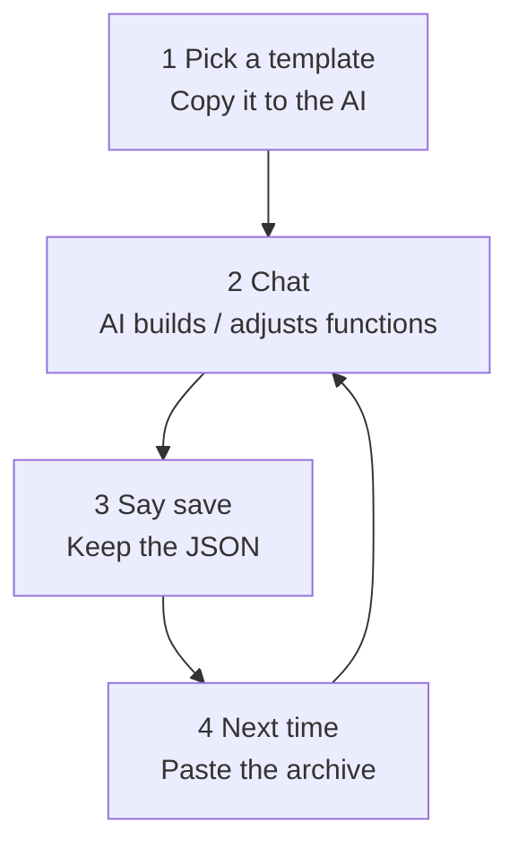

# 🤖 json-prompt-form

[](./LICENSE)
[](./form.json)
[](https://github.com/TuxLin123233/json-prompt-form/stargazers)
[](https://github.com/TuxLin123233/json-prompt-form/commits/main)

[中文](./README.md) · [English](./README.en.md)


> An AI companion template that actually remembers you. If you can copy and paste, you can use it. ✨

## ✨ What is this?

Think of it as a **long-term companionship manual for an AI**, plus a **save file you can resume from again and again**.

A normal prompt is forgotten once the chat ends. This template lets the AI read your save file each time and continue where you left off.

- 🧰 No installation
- 👌 No coding
- 💬 Works with any web AI (e.g. DeepSeek, ChatGPT)
- 🚀 **One-click copy page**: [tuxlin123233.github.io/json-prompt-form](https://tuxlin123233.github.io/json-prompt-form/)

## 🚀 Start in 3 steps

**1️⃣ Pick a scenario**
Choose the closest one in [`examples/`](./examples), or use [`form.json`](./form.json) to build your own. Or open the [one-click copy page](https://tuxlin123233.github.io/json-prompt-form/). To combine functions yourself, use the [custom builder](https://tuxlin123233.github.io/json-prompt-form/builder.html).

**2️⃣ Copy the whole file to the AI**
Paste the entire JSON, then add one sentence about your real situation.

**3️⃣ Say "save" when you finish**
The AI returns a JSON archive. Keep it. Next time, paste the date + archive to resume. If the archive is too long, say "compact archive" and it keeps only the essential fields; to resume, paste the original template and the compact archive together.

### 📋 Copy-paste templates

**First time:**
```
<paste the whole scenario JSON here>

Today is 2026-11-15. My situation is: ... (the more specific, the better)
```

**Every time after:**
```
Today is 2026-11-20. Here is my archive, please continue:
<paste the JSON archive you saved last time>
```

**When finishing:**
> Say "save" or "存档". Copy the whole content of the ```` ```json ```` code block and keep it.

> 💡 Tip: copy only the JSON inside the code block, not the AI's explanation. If the archive is cut off, reply "continue" to get the remaining parts.

### 🧰 More tools

- 🛠️ [Custom builder](https://tuxlin123233.github.io/json-prompt-form/builder.html): answer a few questions and generate your own template.
- 🔍 [Archive checker](https://tuxlin123233.github.io/json-prompt-form/checker.html): validate, format, and detect truncated archives.
- 🕘 Search and recent scenarios on the home page.
- 📱 Installable on your phone home screen; works offline.
- 🧩 English templates in [`examples/en/`](./examples/en); filled sample archives in [`examples/filled/`](./examples/filled).

## 🔄 How it works



## 🗂️ Files

| File | What it is |
| --- | --- |
| 📄 [`form.json`](./form.json) | Generic template for custom scenarios |
| 🎯 [`examples/`](./examples) | 26 ready-to-use scenarios |
| 🖥️ [`index.html`](./index.html) | One-click copy + scenario picker |
| 🛠️ [`builder.html`](./builder.html) | Custom builder: answer questions, get a template |
| 🔍 [`checker.html`](./checker.html) | Archive checker: validate / format / detect truncation |
| 🧩 [`examples/en/`](./examples/en) | 26 English scenario templates |
| 💾 [`examples/filled/`](./examples/filled) | Filled sample archives with dates and memory |
| 🌐 [`form.en.json`](./form.en.json) | English generic template |
| 🔍 [`schema.json`](./schema.json) | Optional archive validator |
| 🔁 [`scripts/migrate.py`](./scripts/migrate.py) | Migrate older archives |
| 🤖 [`llms.txt`](./llms.txt) | Project summary for AI search tools |
| 📜 [`CHANGELOG.md`](./CHANGELOG.md) | Version history |
| 💬 [`docs/example-dialogue.md`](./docs/example-dialogue.md) | A full example conversation |
| ❓ [`FAQ.md`](./FAQ.md) | FAQ (Chinese) |
| 🤝 [`CONTRIBUTING.md`](./CONTRIBUTING.md) | How to add a scenario (Chinese) |

## 🎯 Scenarios

| Scenario | File | Best for | Daily |
| --- | --- | --- | --- |
| 📚 Exam prep | [`study-exam.json`](./examples/study-exam.json) | Gaokao, grad school, certifications | 5 min |
| 💪 Fitness | [`fitness.json`](./examples/fitness.json) | Muscle gain, fat loss, consistency | 5 min |
| 💼 Job search | [`job-search.json`](./examples/job-search.json) | Applications, interviews, anxiety | 10 min |
| 🌤️ Emotional support | [`emotion-support.json`](./examples/emotion-support.json) | Anxiety, low mood, stress | 5 min |
| 💰 Finance | [`finance.json`](./examples/finance.json) | Overspending, saving, debt | 5 min |
| ✍️ Writing | [`writing.json`](./examples/writing.json) | Novels, newsletters, daily writing | 10 min |
| 🌙 Sleep | [`sleep.json`](./examples/sleep.json) | Falling asleep, late nights, poor sleep | 5 min |
| 🚭 Quit habits | [`quit-habits.json`](./examples/quit-habits.json) | Smoking, sugar, phone addiction | 5 min |
| 🗣️ Language learning | [`language-learning.json`](./examples/language-learning.json) | Speaking, vocabulary, exams | 10 min |
| 👨‍👩‍👧 Parenting | [`parenting.json`](./examples/parenting.json) | Better parent-child communication | 10 min |
| 🤝 Caregiver | [`caregiver.json`](./examples/caregiver.json) | Caring for family, avoiding burnout | 5 min |
| 🧠 ADHD support | [`adhd.json`](./examples/adhd.json) | Focus, procrastination, forgetfulness | 5 min |
| 📖 Reading | [`reading.json`](./examples/reading.json) | Building a reading habit | 10 min |
| 🐾 Pets | [`pet.json`](./examples/pet.json) | Daily care and training records | 5 min |
| ⏰ Time management | [`time-management.json`](./examples/time-management.json) | Overwhelmed, busy but unproductive | 5 min |
| 🌅 Morning routine | [`morning-routine.json`](./examples/morning-routine.json) | Can't get up, chaotic mornings | 5 min |
| 🧘 Mindfulness | [`meditation.json`](./examples/meditation.json) | Tense, anxious, racing mind at night | 5 min |
| 🥗 Healthy eating | [`healthy-diet.json`](./examples/healthy-diet.json) | Too much takeout, irregular meals | 5 min |
| 📓 Journaling | [`journaling.json`](./examples/journaling.json) | Can't keep a journal, wants clarity | 5 min |
| 🎤 Public speaking | [`public-speaking.json`](./examples/public-speaking.json) | Nervous speaking, unstructured reports | 10 min |
| 💞 Relationships | [`relationship.json`](./examples/relationship.json) | Frequent arguments with partner | 5 min |
| 🧹 Decluttering | [`declutter.json`](./examples/declutter.json) | Cluttered home, hard to let go | 15 min |
| 🎸 Instrument practice | [`instrument.json`](./examples/instrument.json) | Learning an instrument, keeps quitting | 15 min |
| 💻 Coding | [`coding.json`](./examples/coding.json) | Self-taught coding, gets stuck or lost | 20 min |
| 🍳 Cooking | [`cooking.json`](./examples/cooking.json) | Can't cook, wants to meal-prep | 20 min |
| 🪴 Plant care | [`plant-care.json`](./examples/plant-care.json) | Loves plants but keeps killing them | 5 min |

Every template adapts to your real situation and proposes new functions as you chat.

English templates are in [`examples/en/`](./examples/en). To see what a filled archive looks like, open [`examples/filled/`](./examples/filled).

## 🧠 How does it remember you?

1. The AI has no memory and cannot read your files 📭
2. So you paste the archive to it each time 📎
3. At the end it returns the updated archive and you keep it 💾

The archive stays with you: no upload, no account.

## 🛟 Safety

- This is a companionship and self-management tool. **It does not provide medical, psychological, legal, or financial diagnosis.**
- In a serious emotional crisis, contact local emergency services or a crisis hotline, or tell someone you trust.
- Archives may contain private information. Keep them safe.

## 🔧 For contributors

<details>
<summary>Field reference</summary>

| Field | Purpose |
| --- | --- |
| `schema_version` | Archive format version |
| `usage` | Instructions for the AI |
| `goal` | Overall assistant goal |
| `session_context` | Date, pasted archive, no-memory rule |
| `compatibility` | Tolerate old archives: fill missing fields, keep unknown ones |
| `archive_modes` | Full archive / compact archive modes |
| `protocol` | Hard flow: first time / resume / in-session / end (with split archives) |
| `assistant_identity` | What it is, why it exists, how it accompanies |
| `scene` | User's scenario and goals |
| `functions[]` | Function list |
| `function_rules` | Generation, defaults, limits, stale check |
| `evolution` | Add / adjust / retire proposals |
| `rejected_suggestions` | Rejected proposals and reasons |
| `memory` | Long-term state and recent session summaries |
| `safety` | Crisis, privacy, professional boundaries |
| `output_rules` | Tone, language, one-question-at-a-time, output format |
| `examples` | Example dialogues |

### Function fields

```jsonc
{
  "id": "f_emotional_stability",
  "name": "Emotional stability",
  "what": "What it is",
  "why": "Why it exists",
  "how": "How it works",
  "trigger": "When to trigger",
  "frequency": "daily | weekly | on demand | custom",
  "linked_with": ["f_checkin"],
  "status": "active",              // active | paused | retired
  "source": "initial",             // initial | ai_suggest | user_add | user_modify
  "last_triggered_at": null,
  "created_at": "2026-11-14",
  "updated_at": "2026-11-14"
}
```

### Regenerate and validate

```bash
python3 scripts/generate_examples.py     # Chinese scenarios + filled samples
python3 scripts/generate_en_examples.py  # English scenarios
pip install jsonschema
python3 scripts/validate.py              # validate all JSON
python3 scripts/migrate.py old.json -o new.json  # migrate an old archive
```

</details>

## 📄 License

[MIT](./LICENSE)
