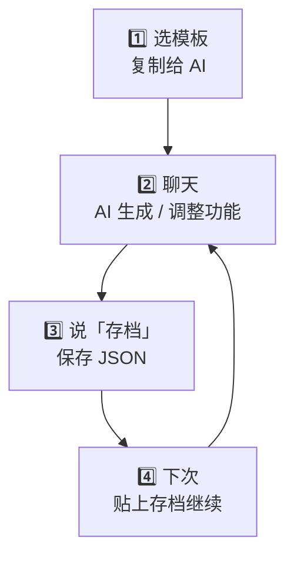

# 一事一练

> 仓库名沿用 `json-prompt-form`，在线地址与存档格式保持不变。

[](./LICENSE)
[](./form.json)
[](https://github.com/TuxLin123233/json-prompt-form/stargazers)
[](https://github.com/TuxLin123233/json-prompt-form/commits/main)


> 一次只练一件事。一个能「记住你」的 AI 长期陪练模板，会复制粘贴就能用。✨

## ✨ 这是什么？

把它想成一张**给 AI 的长期陪练说明书**，外加一份**可以反复续上的存档**。

普通提示词聊完就忘；这个模板能让 AI 每次读你的存档，接着上次继续聊、继续帮你。存档是纯文本 JSON，换一个 AI 也能继续用。

- 🧰 不用安装任何软件
- 👌 不用会写代码
- 💬 打开网页版 AI（如 DeepSeek）就能用
- 🚀 **一键复制网页**：[tuxlin123233.github.io/json-prompt-form](https://tuxlin123233.github.io/json-prompt-form/)
- 🎯 **每个练点都有训练计划**：练什么能力、建议节奏、什么算过关
- ✅ **打卡可写回存档**：本周练习卡本地记录打卡，合并进 `progress` 字段，不上传

## 🚀 三步开始

**1️⃣ 选一个场景**
去 [`examples/`](./examples) 找一个最像你的；都不像就用 [`form.json`](./form.json)。也可以打开[一键复制网页](https://tuxlin123233.github.io/json-prompt-form/)，点一下直接复制。想自己组合功能，用[自定义生成器](https://tuxlin123233.github.io/json-prompt-form/builder.html)。

**2️⃣ 整份复制，发给 AI**
把选好的 JSON **全部内容**粘贴给 AI，再补一句你的真实情况。

**3️⃣ 聊完说「存档」**
AI 会给你一段 JSON，整段保存下来。下次开场贴「今天日期 + 存档」，就能接着来。存档太长时，对 AI 说「精简存档」，它只保留关键字段；续接时把原始模板和精简存档一起贴入。

### 📋 照着复制就行

**第一次用：**
```
<把选好的 JSON 整份粘贴在这里>

今天是 2026-11-15。我的情况是：……（越具体越好）
```

**以后每次：**
```
今天是 2026-11-20。这是我的存档，请继续：
<把上次保存的 JSON 整段粘贴在这里>
```

> 🔄 如果存档是旧模板生成的：把当前 `form.json` 和旧存档一起贴入，AI 会按 `compatibility.updates` 自动升级，并用一行说明。迁移只补齐/改名，不覆盖你的内容。

**结束时：**
> 对 AI 说「存档」或「保存」，然后把回答里 ```` ```json ```` 代码块中的内容整段复制保存。

> 💡 小提醒：只复制代码块里的 JSON，不要复制 AI 的寒暄和解释。存档太长被截断时，回复「继续」让它分段发完。

### 🧰 更多工具

- 🛠️ [自定义生成器](https://tuxlin123233.github.io/json-prompt-form/builder.html)：回答几个问题，现场生成自己的模板。
- 🔍 [存档检查器](https://tuxlin123233.github.io/json-prompt-form/checker.html)：粘贴存档，检查格式、字段和截断。
- 🕘 首页支持搜索和「最近使用」，会记住你点过的场景。
- 📱 可添加到手机主屏幕，离线也能打开。
- 🧩 英文模板在 [`examples/en/`](./examples/en)，填好日期和记忆的示例存档在 [`examples/filled/`](./examples/filled)。

## 🔄 它怎么运转



## 🗂️ 文件说明

| 文件 | 是什么 |
| --- | --- |
| 📄 [`form.json`](./form.json) | 通用模板，适合自定义场景 |
| 🧭 [`scenarios.json`](./scenarios.json) | 练点索引：名称/分类/时长/关键词/能力点/过关标准（机器可读，校验基准） |
| 🎛️ [`assets/icons/`](./assets/icons) | 场景图标（来自 Lucide，ISC 许可） |
| 🎯 [`examples/`](./examples) | 六十个现成场景，复制即用 |
| 🖥️ [`index.html`](./index.html) | 一键复制 + 练点选择网页 |
| 🔁 [`transfer.html`](./transfer.html) | 换 AI 续接演示：同一份存档换模型接着练 |
| 🗓️ [`week.html`](./week.html) | 本周练习卡：选练点生成 7 天安排，可复制/下载/打印 |
| 🛠️ [`builder.html`](./builder.html) | 自定义生成器：回答问题生成模板 |
| 🔍 [`checker.html`](./checker.html) | 存档检查器：校验 / 格式化 / 查截断 |
| 🧩 [`examples/en/`](./examples/en) | 27 个英文场景模板 |
| 💾 [`examples/filled/`](./examples/filled) | 填好日期和记忆的示例存档 |
| 🌐 [`form.en.json`](./form.en.json) | 英文版通用模板 |
| 🔍 [`schema.json`](./schema.json) | 可选：给懂技术的人检查存档格式 |
| 🔄 [`updates.json`](./updates.json) | 版本迁移清单：旧存档如何升级到当前模板 |
| 🔁 [`scripts/migrate.py`](./scripts/migrate.py) | 旧存档迁移工具（读取 `updates.json`） |
| 🤖 [`llms.txt`](./llms.txt) | 给 AI 搜索工具的项目说明 |
| 📜 [`CHANGELOG.md`](./CHANGELOG.md) | 版本更新记录 |
| 💬 [`docs/example-dialogue.md`](./docs/example-dialogue.md) | 一段完整示例对话 |
| ❓ [`FAQ.md`](./FAQ.md) | 常见问题 |
| 🤝 [`CONTRIBUTING.md`](./CONTRIBUTING.md) | 如何新增场景 |

## 🎯 60 个练点

| 场景 | 文件 | 适合谁 | 每日 |
| --- | --- | --- | --- |
| 📚 备考 | [`study-exam.json`](./examples/study-exam.json) | 中高考、考研、考证，容易拖延焦虑 | 5 分钟 |
| 💪 健身 | [`fitness.json`](./examples/fitness.json) | 想增肌减脂塑形，但总坚持不下来 | 5 分钟 |
| 💼 求职 | [`job-search.json`](./examples/job-search.json) | 投简历没回音、面试紧张、求职焦虑 | 10 分钟 |
| 🌤️ 情绪支持 | [`emotion-support.json`](./examples/emotion-support.json) | 焦虑、低落、压力大，想有个出口 | 5 分钟 |
| 💰 财务 | [`finance.json`](./examples/finance.json) | 月光、超支、想存钱或还债 | 5 分钟 |
| ✍️ 写作 | [`writing.json`](./examples/writing.json) | 小说、公众号、日更，总卡文拖延 | 10 分钟 |
| 🌙 睡眠 | [`sleep.json`](./examples/sleep.json) | 入睡难、熬夜、睡眠质量差 | 5 分钟 |
| 🚭 戒烟戒糖 | [`quit-habits.json`](./examples/quit-habits.json) | 想戒烟、戒糖、戒手机等习惯 | 5 分钟 |
| 🗣️ 语言学习 | [`language-learning.json`](./examples/language-learning.json) | 练口语、背单词、备考语言考试 | 10 分钟 |
| 👨‍👩‍👧 亲子沟通 | [`parenting.json`](./examples/parenting.json) | 想改善亲子沟通、减少吼叫 | 10 分钟 |
| 🤝 照护者支持 | [`caregiver.json`](./examples/caregiver.json) | 照顾老人病人、容易疲惫的人 | 5 分钟 |
| 🧠 ADHD 支持 | [`adhd.json`](./examples/adhd.json) | 注意力涣散、拖延、容易忘事 | 5 分钟 |
| 📖 读书 | [`reading.json`](./examples/reading.json) | 买书不读、想建立阅读习惯 | 10 分钟 |
| 🐾 宠物 | [`pet.json`](./examples/pet.json) | 养猫狗，想科学陪伴和记录 | 5 分钟 |
| ⏰ 时间管理 | [`time-management.json`](./examples/time-management.json) | 事多拖延、忙但没产出 | 5 分钟 |
| 🌅 早起晨间 | [`morning-routine.json`](./examples/morning-routine.json) | 起不来、早晨手忙脚乱 | 5 分钟 |
| 🧘 正念练习 | [`meditation.json`](./examples/meditation.json) | 紧绷焦虑、睡前脑子停不下来 | 5 分钟 |
| 🥗 健康饮食 | [`healthy-diet.json`](./examples/healthy-diet.json) | 外卖多、饮食不规律、想吃得健康 | 5 分钟 |
| 📓 日记觉察 | [`journaling.json`](./examples/journaling.json) | 想写日记但坚持不了、想梳理情绪 | 5 分钟 |
| 🎤 演讲表达 | [`public-speaking.json`](./examples/public-speaking.json) | 当众发言紧张、汇报没结构 | 10 分钟 |
| 💞 恋爱沟通 | [`relationship.json`](./examples/relationship.json) | 恋爱或伴侣沟通中容易争吵 | 5 分钟 |
| 🧹 整理收纳 | [`declutter.json`](./examples/declutter.json) | 房间乱、东西多、舍不得扔 | 15 分钟 |
| 🎸 乐器练习 | [`instrument.json`](./examples/instrument.json) | 学乐器、练琴容易中断 | 15 分钟 |
| 💻 编程学习 | [`coding.json`](./examples/coding.json) | 自学编程、容易卡住或迷路 | 20 分钟 |
| 🍳 学做饭 | [`cooking.json`](./examples/cooking.json) | 不会做饭、想开始带饭 | 20 分钟 |
| 🪴 植物养护 | [`plant-care.json`](./examples/plant-care.json) | 喜欢绿植但总养死 | 5 分钟 |
| 🗂️ 项目推进 | [`project.json`](./examples/project.json) | 论文、作品、副业等长期项目推进 | 10 分钟 |
| 🏃 跑步 | [`running.json`](./examples/running.json) | 从零开始跑步，想坚持又怕受伤 | 15 分钟 |
| 🪑 久坐体态 | [`posture.json`](./examples/posture.json) | 肩颈腰背僵硬、圆肩驼背 | 10 分钟 |
| 😶‍🌫️ 社交焦虑 | [`social-anxiety.json`](./examples/social-anxiety.json) | 社交前紧张、事后反复回想 | 10 分钟 |
| 🫂 自我关怀 | [`self-compassion.json`](./examples/self-compassion.json) | 容易自责、完美主义 | 5 分钟 |
| 🚗 学车考驾照 | [`driving.json`](./examples/driving.json) | 科目二紧张、易错点反复错 | 10 分钟 |
| 📑 论文毕设 | [`thesis.json`](./examples/thesis.json) | 论文拖延、不知道从哪写起 | 20 分钟 |
| 💬 职场沟通 | [`workplace-comm.json`](./examples/workplace-comm.json) | 和领导沟通紧张、不会拒绝 | 10 分钟 |
| 💡 副业启动 | [`side-hustle.json`](./examples/side-hustle.json) | 想做副业但不知道从哪开始 | 15 分钟 |
| 🎯 专注力 | [`focus.json`](./examples/focus.json) | 一坐下就刷手机、注意力碎片化 | 10 分钟 |
| 瑜伽 | [`yoga.json`](./examples/yoga.json) | 想在家练瑜伽，但不知道怎么开始 | 10 分钟 |
| 骑行 | [`cycling.json`](./examples/cycling.json) | 想靠骑车锻炼，但坚持不下来 | 20 分钟 |
| 游泳 | [`swimming.json`](./examples/swimming.json) | 想学游泳或坚持游泳，但怕水、没节奏 | 20 分钟 |
| 徒步户外 | [`hiking.json`](./examples/hiking.json) | 想开始徒步，但不知道准备什么 | 20 分钟 |
| 护眼用眼 | [`eye-care.json`](./examples/eye-care.json) | 长时间看屏幕，眼睛干涩疲劳 | 5 分钟 |
| 情绪化进食 | [`emotional-eating.json`](./examples/emotional-eating.json) | 压力一大就想吃东西 | 10 分钟 |
| 失恋恢复 | [`breakup.json`](./examples/breakup.json) | 分手后走不出来，反复回想 | 10 分钟 |
| 愤怒管理 | [`anger.json`](./examples/anger.json) | 容易发火，事后又后悔 | 5 分钟 |
| 自信表达 | [`confidence.json`](./examples/confidence.json) | 想表达自己，却总是不敢开口 | 10 分钟 |
| 与父母沟通 | [`parents.json`](./examples/parents.json) | 和父母说不到两句就吵起来 | 10 分钟 |
| 家庭分工 | [`chores.json`](./examples/chores.json) | 家务总是自己干，心里不平衡 | 10 分钟 |
| 友情维护 | [`friendship.json`](./examples/friendship.json) | 朋友越来越少，不知道该怎么联系 | 5 分钟 |
| 陪写作业 | [`study-parenting.json`](./examples/study-parenting.json) | 陪孩子写作业，天天鸡飞狗跳 | 15 分钟 |
| 留学申请 | [`study-abroad.json`](./examples/study-abroad.json) | 想申请留学，但流程复杂没头绪 | 20 分钟 |
| 职场新人 | [`new-job.json`](./examples/new-job.json) | 刚入职，不知道怎么融入 | 10 分钟 |
| 升职述职 | [`promotion.json`](./examples/promotion.json) | 想争取升职，但不知道怎么准备 | 10 分钟 |
| 团队管理 | [`team-management.json`](./examples/team-management.json) | 第一次带团队，不知道怎么管 | 15 分钟 |
| 自由职业接单 | [`freelance.json`](./examples/freelance.json) | 想做自由职业，但接单不稳定 | 15 分钟 |
| 绘画练习 | [`painting.json`](./examples/painting.json) | 想学画画，但总是画两笔就停 | 15 分钟 |
| 摄影 | [`photography.json`](./examples/photography.json) | 想学摄影，但拍来拍去没进步 | 15 分钟 |
| 唱歌练习 | [`singing.json`](./examples/singing.json) | 想学唱歌，但总跑调、没气息 | 15 分钟 |
| 练字书法 | [`calligraphy.json`](./examples/calligraphy.json) | 想练字，但总坚持不下来 | 10 分钟 |
| 旅行规划 | [`travel.json`](./examples/travel.json) | 想出去玩，但做攻略太累 | 10 分钟 |
| 独居生活 | [`solo-living.json`](./examples/solo-living.json) | 一个人住，生活容易乱套 | 10 分钟 |

每个练点都会根据你的实际情况调整功能，也会在聊天中主动提议加新功能。点开「预览」可以看到该练点的训练计划：练什么能力、建议节奏、过关标准。

英文模板在 [`examples/en/`](./examples/en)；想看填好的存档长什么样，打开 [`examples/filled/`](./examples/filled)。

## 🧠 它怎么记住你？

1. AI 本身不记事，也看不到你的文件 📭
2. 所以每次由你把「存档」贴给它 📎
3. 聊完它把更新后的完整存档还给你，你保存好 💾

存档只在你手里，不上传、不联网、不依赖账号。

## 🛟 安全提醒

- 这是陪伴和自我管理工具，**不做医疗、心理、法律、投资等专业诊断** 🩺
- 遇到严重情绪危机，请第一时间联系当地急救/危机热线，或告诉身边可信任的人 🆘
- 存档可能包含你的隐私，请自己妥善保管 🔒

## ❓ 常见问题

- AI 不输出 JSON / 只输出一半怎么办？
- 换一个 AI 还能接着用吗？
- 存档存哪里、隐私安全吗？
- 可以同时用好几个助手吗？

👉 见 [FAQ.md](./FAQ.md)，或直接看[完整示例对话](./docs/example-dialogue.md)。

延伸阅读：[为什么普通提示词记不住你](./docs/why-prompts-forget.md) · [30 秒演示脚本](./docs/demo-script.md) · [发布清单](./docs/publish-checklist.md)。

## 🔧 进阶：内部结构（给想改的人）

<details>
<summary>点开查看字段说明</summary>

| 字段 | 作用 |
| --- | --- |
| `schema_version` | 存档格式版本 |
| `usage` | 给 AI 的使用说明 |
| `goal` | 助手总目标 |
| `session_context` | 本次日期、贴入的存档、无记忆规则 |
| `compatibility` | 旧存档容错：缺字段补齐、未知字段保留 |
| `archive_modes` | 完整存档 / 精简存档两种模式 |
| `protocol` | 硬流程：首次 / 续接 / 会话中 / 收尾（含分段存档） |
| `assistant_identity` | 助手是什么、为什么存在、怎么陪伴 |
| `scene` | 用户要什么场景、为什么、怎么用 |
| `functions[]` | 功能列表 |
| `function_rules` | 功能生成、默认值、数量上限、过期检查 |
| `evolution` | 新增 / 调整 / 停用功能的演化规则 |
| `rejected_suggestions` | 被拒绝的提议及原因 |
| `memory` | 长期状态与近期会话摘要 |
| `safety` | 危机、隐私与专业边界 |
| `output_rules` | 语气、语言、一次一问、收尾格式、分段兜底 |
| `examples` | 各类对话示例 |

### 功能字段

```jsonc
{
  "id": "f_emotional_stability",   // f_ + 英文短名，创建后不变
  "name": "情绪稳定",
  "what": "是什么",
  "why": "为什么",
  "how": "怎么办",
  "trigger": "什么时候触发",
  "frequency": "每日 | 每周 | 按需 | 自定义（写明）",
  "linked_with": ["f_checkin"],    // 引用 id
  "status": "active",              // active | paused | retired
  "source": "initial",             // initial | ai_suggest | user_add | user_modify
  "last_triggered_at": null,
  "created_at": "2026-11-14",
  "updated_at": "2026-11-14"
}
```

### 新增场景 / 修改模板

```bash
python3 scripts/generate_examples.py     # 从 form.json 生成中文场景 + 已填示例
python3 scripts/generate_en_examples.py  # 从 form.en.json 生成英文场景
pip install jsonschema
python3 scripts/validate.py              # 校验全部 JSON
python3 scripts/migrate.py 旧存档.json -o 新存档.json  # 迁移旧存档
```

修改存档结构时，请同时提升 `schema_version`、在 [`updates.json`](./updates.json) 增加一条迁移，并同步 `form.json` / `form.en.json` 的 `compatibility.updates`；`scripts/validate.py` 会检查清单与模板是否漂移。

新增场景的步骤见 [CONTRIBUTING.md](./CONTRIBUTING.md)。把 [`docs/ci/validate.yml`](./docs/ci/validate.yml) 放到 `.github/workflows/` 后，CI 会在每次 push 时自动校验。

### 可选校验

```bash
npx ajv-cli validate -s schema.json -d 存档.json
```

</details>

## 🙏 致谢与版权

- 首页插画来自 [unDraw](https://undraw.co/illustrations)，已统一改为灰白配色，遵循其开源许可；插画版权归 unDraw 原作者所有。
- 场景图标来自 [Lucide](https://lucide.dev)，遵循 [ISC 许可](./assets/icons/LICENSE)；图标已随卡片颜色适配。
- 感谢所有提出场景建议和反馈的人。

© 2026 LinSifan。代码以 [MIT](./LICENSE) 许可发布。

## 📄 License

[MIT](./LICENSE)
